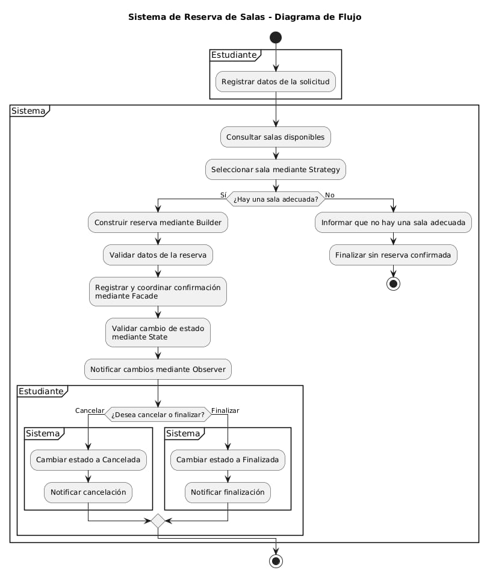

# Estación 1. Comprender el problema y modelar el flujo

## Diagrama de flujo

### Descripción del flujo
1. El estudiante registra los datos de la solicitud (identificador, nombre, fecha, hora de inicio, duración, cantidad de personas y criterio de selección).
2. El sistema consulta las salas disponibles.
3. Una estrategia selecciona la sala (por capacidad o por sala preferida).
4. **Decisión: ¿hay una sala adecuada?**
   - **No:** el proceso termina sin crear una reserva confirmada.
   - **Sí:** continúa el flujo.
5. El Builder construye la reserva y valida los datos. La reserva queda en estado *Pendiente*.
6. La fachada (Facade) registra la reserva y coordina la confirmación.
7. El patrón State valida el cambio de estado (Pendiente → Confirmada).
8. El patrón Observer comunica el cambio a los suscriptores (notificación al estudiante y registro del evento).
9. El estudiante puede cancelar o finalizar la reserva según su estado actual.

## Responsabilidades que no deben quedar concentradas en Main

| # | Responsabilidad | Clase(s) responsable(s) |
|---|-----------------|-------------------------|
| 1 | Representar los datos del estudiante y de las salas | `Estudiante`, `Sala` |
| 2 | Consultar las salas disponibles | `RepositorioSalas`, `RepositorioSalasMemoria` |
| 3 | Seleccionar la sala según un criterio | `EstrategiaSeleccionSala`, `SeleccionPorCapacidad`, `SeleccionSalaPreferida` |
| 4 | Construir la reserva y validar sus datos | `ReservaBuilder` |
| 5 | Registrar y almacenar las reservas | `RepositorioReservas`, `RepositorioReservasMemoria` |
| 6 | Coordinar el caso de uso completo | `ReservaFacade` |
| 7 | Controlar las transiciones válidas de estado | `EstadoReserva`, `Pendiente`, `Confirmada`, `Cancelada`, `Finalizada` |
| 8 | Notificar los cambios de estado | `ObservadorReserva`, `NotificadorEstudiante`, `RegistroEventos` |

`Main` solo debe configurar las dependencias e iniciar el flujo.

## Comprobación

**¿Por qué una clase Main que consulta salas, valida datos, construye reservas, notifica y controla estados tendría baja cohesión y sería difícil de mantener?**

Una clase así tendría **baja cohesión** porque sus métodos atenderían propósitos muy distintos entre sí: acceso a datos, reglas de validación, algoritmos de selección, manejo del ciclo de vida y notificaciones. No tendría una única razón para cambiar, lo que viola el **Principio de Responsabilidad Única (SRP)** y la convierte en el antipatrón **God Object**.

Sería **difícil de mantener** porque:
- Cualquier cambio, como agregar un criterio de selección, un nuevo estado o otro tipo de notificación, obligaría a modificar la misma clase. Eso aumenta el riesgo de romper funcionalidades que ya sirven.
- Las reglas de estado terminarían como cadenas de `if/else` sobre variables `String`, propensas a errores.
- Sería difícil probar cada parte por separado, porque todo estaría acoplado.
- El código crecería sin orden y sería difícil de leer y de reutilizar.

Separar las responsabilidades en clases especializadas permite que cada una cambie de forma independiente, facilita las pruebas y permite extender el sistema sin modificar el código existente (**Principio Abierto/Cerrado**).
